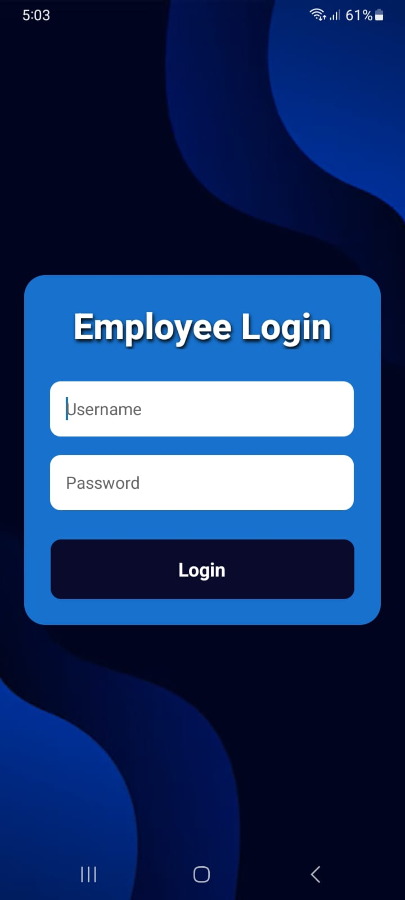

# Employee Login & Attendance App

A mobile application built using **React Native, Expo, and JavaScript (JSX)** to provide employee authentication and attendance management. The app features a simple login interface and an attendance screen where employees can view their attendance records through a clean and user-friendly design.

## Screenshots

<p align="center">
  
</p>

<p align="center">
  <i>Employee Login Screen | Attendance Dashboard (removed due to privacy reasons) </i>
</p>

## Features

-  Employee login and authentication.
-  Employee attendance dashboard.
-  View attendance records and dates.
-  Display check-in times and attendance status.
-  Clean and user-friendly interface.
-  Mobile application developed with Expo.

## Technologies Used

- **React Native** — Mobile app development.
- **Expo** — Development and testing.
- **JavaScript (JSX)** — Application logic and UI.
- **Expo Router** — Navigation between screens.
- **Axios** — API requests.
- **AsyncStorage** — Local session-state storage.
- **REST API** — Backend communication.

##  Project Structure

```text
Employee-Attendance-App/
├── app/
│   ├── index.jsx
│   ├── _layout.jsx
│   └── attendance/
│       └── index.jsx
├── services/
│   ├── authService.js
│   └── attendanceService.js
├── assets/
├── screenshots/
│   ├── login-screen.png
├── app.json
├── package.json
└── README.md
```

## Getting Started

### Prerequisites

- [Node.js](https://nodejs.org/)
- npm
- [Expo Go](https://expo.dev/go) or a compatible emulator.

### Installation

**1. Clone the repository**

```bash
git clone https://github.com/S-Eraj-Zehra/Emp_Login.git
```

**2. Navigate to the project folder**

```bash
cd Emp_Login
```

**3. Install dependencies**

```bash
npm install
```

**4. Configure the backend**

If your app connects to a backend API, configure the API base URL in the relevant service files. Ensure your mobile device and backend server can communicate over the network.

**5. Start the Expo development server**

```bash
npx expo start
```

Scan the QR code with a compatible Expo Go version or run the application using an available emulator.

## 🔑 Application Workflow

1. The employee opens the application.
2. The employee enters their login credentials.
3. The application sends the login request to the configured authentication API.
4. After successful authentication, the employee is directed to the attendance screen.
5. The employee can view available attendance records, including dates, check-in times, and attendance status.
6. The employee can log out of the application.

## Security Notes

- Do not commit passwords, private API keys, or other secrets to GitHub.
- Use HTTPS for production API communication.
- Implement proper authentication and authorization on the backend.
- Protect stored session credentials appropriately.

## Future Improvements

- [ ] Add employee profile details.
- [ ] Implement check-in and check-out functionality.
- [ ] Add attendance summaries and monthly reports.
- [ ] Improve form validation and error handling.
- [ ] Add secure token-based authentication.
- [ ] Enhance the interface with additional animations and visual improvements.

## Author

**Syeda Eraj Zehra**

- GitHub: [@S-Eraj-Zehra](https://github.com/S-Eraj-Zehra)
- LinkedIn: https://www.linkedin.com/in/e-zehra/

## 📄 License

This project was developed for learning and application development purposes. Add an appropriate open-source license if you intend to distribute it under specific terms.

---

<p align="center">
  Built using React Native and Expo
</p>
